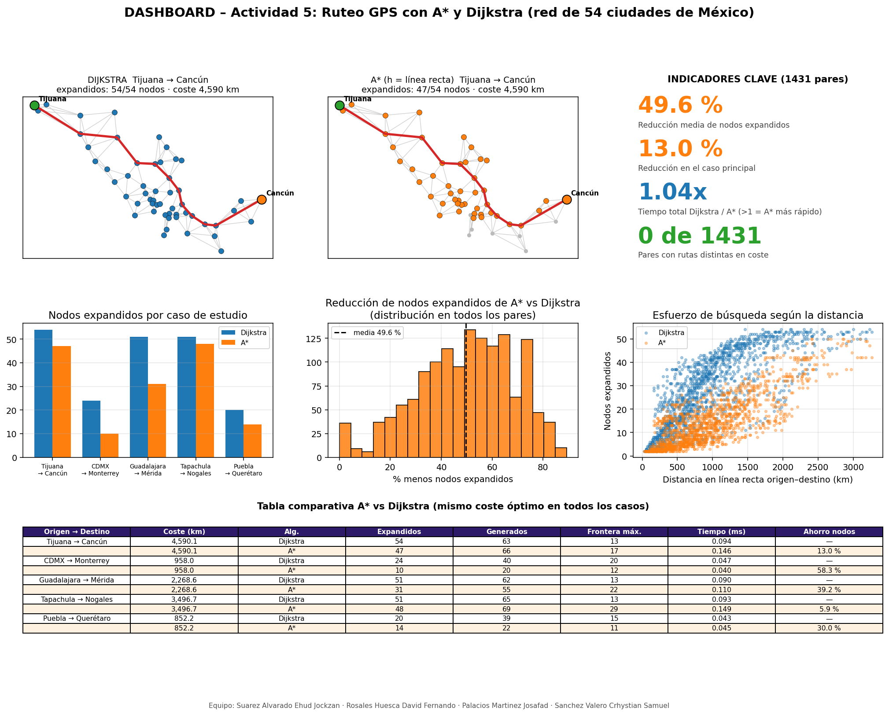
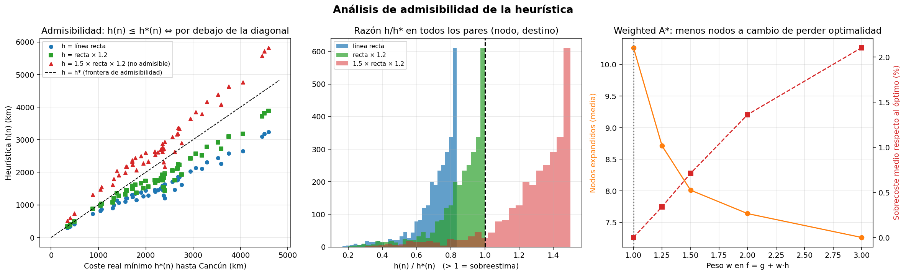

# Actividad 5 · Búsqueda con heurísticas: A\* vs Dijkstra (ruteo GPS)

**Universidad:** Politécnica de Atlautla · **Programa:** Ing. en Tecnologías de la Información e Innovación Digital
**Asignatura:** Fundamentos de Inteligencia Artificial · **Docente:** Mtro. Javier García Lara
**Sección:** 2.5 Búsqueda con heurísticas (A\* / Dijkstra) · **Tipo:** Proyecto en equipo · **Entrega:** 25-Oct-2026

## Integrantes del equipo

| # | Nombre |
|---|--------|
| 1 | Suarez Alvarado Ehud Jockzan |
| 2 | Rosales Huesca David Fernando |
| 3 | Palacios Martinez Josafad |
| 4 | Sanchez Valero Crhystian Samuel |

---

## 1. Descripción del caso

Un navegador GPS debe encontrar la **ruta de menor distancia** entre dos ciudades de México. Se modeló una red de **54 ciudades** (coordenadas GPS aproximadas) y se compararon dos algoritmos:

- **Dijkstra:** expande los nodos por menor coste acumulado `g(n)`. Es óptimo, pero no usa información sobre el destino.
- **A\*:** expande por `f(n) = g(n) + h(n)`, con `h(n)` = distancia en línea recta (Haversine) al destino.

### Modelado como problema de búsqueda

| Elemento | Definición |
|---|---|
| Estado | Ciudad actual |
| Acciones | Viajar a una ciudad conectada por un tramo carretero |
| Coste | Distancia del tramo en km |
| Meta | Ciudad destino |
| Grafo | No dirigido y ponderado. 54 nodos y 143 aristas |

La red se construye conectando cada ciudad con sus **4 ciudades más cercanas**. El peso de cada tramo es `Haversine × 1.2`.

> ⚠️ **Limitaciones (declararlas en el informe):** la red es una **aproximación** por proximidad, no el mapa oficial de carreteras. El factor 1.2 es un **supuesto** de sinuosidad. Las coordenadas son aproximadas y los pesos son distancias, no tiempos ni tráfico. Los resultados valen para este modelo, no para las carreteras reales.

---

## 2. Estructura del repositorio

```
.
├── actividad5_astar_dijkstra.py   # Código completo (modelo, algoritmos, verificación, dashboard)
├── requirements.txt               # Dependencias
├── a5_dashboard.png               # Dashboard principal (mapas, KPIs, gráficas y tabla)
├── a5_admisibilidad.png           # Análisis de admisibilidad
├── a5_resultados.csv              # Resultados numéricos
└── README.md                      # Este instructivo
```

(Renombrar `README_actividad5.md` a `README.md` al subirlo al repositorio.)

## 3. Instalación y ejecución

Requiere **Python 3.9 o superior**.

```bash
# 1) Clonar el repositorio y entrar a la carpeta
git clone <URL-DEL-REPOSITORIO>
cd <carpeta>

# 2) (Opcional) crear un entorno virtual
python -m venv venv
source venv/bin/activate          # Windows: venv\Scripts\activate

# 3) Instalar dependencias
pip install -r requirements.txt

# 4) Ejecutar
python actividad5_astar_dijkstra.py
```

El programa imprime las tablas en consola, guarda los `.png` y el `.csv` junto al script y abre el dashboard con `plt.show()`. En **Google Colab**, sube el `.py` y ejecútalo con `!python actividad5_astar_dijkstra.py`, o pega el código en una celda.

Para cambiar el caso principal, edita `CASO_PRINCIPAL` y `CASOS` al inicio del script.

---

## 4. Librerías utilizadas

| Librería | Uso |
|---|---|
| `numpy` | Estadísticas y arreglos |
| `matplotlib` | Dashboard: mapas, histogramas, dispersión y tabla |
| `networkx` | Grafo y verificación independiente del coste óptimo |
| `heapq`, `itertools`, `math`, `time`, `csv`, `dataclasses`, `pathlib`, `typing` | Biblioteca estándar: cola de prioridad, Haversine, medición de tiempo, CSV |

---

## 5. Resultados

### 5.1 Tabla comparativa de casos de estudio

Todos los costes son iguales entre Dijkstra y A\*: **A\* encontró siempre el óptimo**.

| Origen → Destino | Coste (km) | Expandidos Dijkstra | Expandidos A\* | Ahorro de nodos |
|---|---|---|---|---|
| Tijuana → Cancún | 4 590.1 | 54 | 47 | 13.0 % |
| CDMX → Monterrey | 958.0 | 24 | 10 | 58.3 % |
| Guadalajara → Mérida | 2 268.6 | 51 | 31 | 39.2 % |
| Tapachula → Nogales | 3 496.7 | 51 | 48 | 5.9 % |
| Puebla → Querétaro | 852.2 | 20 | 14 | 30.0 % |

La tabla completa (nodos generados, frontera máxima y tiempos) está en `a5_dashboard.png` y `a5_resultados.csv`.

### 5.2 Experimento completo (1 431 pares de ciudades)

| Algoritmo | Nodos expandidos (media) | Nodos expandidos (mediana) |
|---|---|---|
| Dijkstra | 28.2 | 28.0 |
| A\* (h = línea recta) | 14.3 | 12.0 |
| A\* (h = recta × 1.2) | 10.3 | 8.0 |

- Los costes coincidieron con los de NetworkX en **1 431 de 1 431 pares**.
- A\* con línea recta expande en promedio **49.6 % menos nodos** que Dijkstra. Con `recta × 1.2` la reducción es de **61.7 %**.
- **Tiempo:** en este grafo pequeño el tiempo de reloj es prácticamente igual (relación ≈ 1.0×), porque calcular `h` también cuesta. La ventaja de tiempo de A\* se espera en grafos mucho mayores. Los tiempos varían por equipo.
- **Ahorro vs distancia:** es mayor en rutas cortas y medias y menor en las que cruzan todo el país (Tapachula → Nogales: 5.9 %), porque Dijkstra también tiene que explorar casi toda la red.

### 5.3 Ruta óptima Tijuana → Cancún (4 590.1 km)

Tijuana → Hermosillo → Chihuahua → Torreón → Saltillo → Ciudad Victoria → Tampico → Poza Rica → Veracruz → Coatzacoalcos → Villahermosa → Cancún

### 5.4 Dashboard



---

## 6. Análisis de admisibilidad de la heurística

Una heurística es **admisible** si nunca sobreestima el coste real: `h(n) ≤ h*(n)`. Con una `h` admisible, A\* es **óptimo**. Es **consistente** si `h(u) ≤ w(u,v) + h(v)` en cada arista.

**Por qué `h = línea recta` es admisible aquí:** cada arista pesa `1.2 × su distancia en línea recta`, que es mayor o igual a ella. Por la desigualdad triangular, ningún camino entre dos puntos es más corto que la línea recta que los une. Por tanto `h(n) ≤ h*(n)`.

**Verificación numérica** (todos los pares nodo-destino, 2 862 casos, con `h*` calculada con Dijkstra):

| Heurística | Violaciones de admisibilidad | Violaciones de consistencia | Máx. h/h\* | Veredicto |
|---|---|---|---|---|
| Línea recta (Haversine) | 0 / 2 862 | 0 | 0.833 | Admisible |
| Recta × 1.2 | 0 / 2 862 | 0 | 1.000 | Admisible (la más informada posible aquí) |
| 1.5 × recta × 1.2 | 2 584 / 2 862 | 4 499 | 1.500 | **No admisible** |
| 3 × recta × 1.2 | 2 834 / 2 862 | 6 298 | 3.000 | **No admisible** |

**Qué pasa si se pierde la admisibilidad (Weighted A\*, `f = g + w·h`):**

| w | Nodos expandidos (media) | Sobrecoste medio | Sobrecoste máximo | Pares con ruta óptima |
|---|---|---|---|---|
| 1.0 | 10.3 | 0.00 % | 0.00 % | 1 431 / 1 431 |
| 1.25 | 8.7 | 0.34 % | 7.97 % | 1 187 / 1 431 |
| 1.5 | 8.0 | 0.71 % | 16.12 % | 1 101 / 1 431 |
| 2.0 | 7.6 | 1.36 % | 25.00 % | 961 / 1 431 |
| 3.0 | 7.3 | 2.10 % | 26.32 % | 862 / 1 431 |

Sobreestimar reduce los nodos expandidos, pero **A\* ya no garantiza la ruta óptima**.



## 7. Complejidad

| Algoritmo | Tiempo | Espacio |
|---|---|---|
| Dijkstra (heap binario) | O((V + E) log V) | O(V) |
| A\* | O((V + E) log V) en el peor caso; con buena `h` expande muchos menos nodos | O(V) |

Con `h = 0`, A\* se comporta exactamente como Dijkstra.

## 8. Conclusiones

1. Con `h` admisible y consistente, A\* devolvió el mismo coste óptimo que Dijkstra en todos los pares evaluados.
2. A\* explora aproximadamente la mitad de los nodos, ya que se orienta hacia el destino.
3. Cuanto más se acerca `h` a `h*` sin superarla, menos nodos se expanden.
4. Sobreestimar `h` acelera la búsqueda a costa de perder la optimalidad.
5. Con datos reales (por ejemplo, OpenStreetMap) y grafos mucho más grandes, la diferencia de tiempo debería ser más notoria. Esto no se midió aquí.

---

## 9. Declaración de uso de IA

> *(Ajustar con los datos reales del equipo antes de entregar.)*
>
> - **Herramienta:** Claude (Anthropic).
> - **Prompt:** solicitud del código y análisis de la Actividad 5 (A\* vs Dijkstra con dashboard y análisis de admisibilidad).
> - **Uso:** apoyo en la generación del código, la estructura del dashboard y la redacción del README.
> - **Verificación:** el equipo ejecutó el código, revisó los resultados, contrastó los costes con NetworkX y comprobó las referencias.

## 10. Referencias (APA 7.ª ed.)

- Bohm, R. A. (2021). *The fundamentals of search algorithms*. Nova Science.
- Dijkstra, E. W. (1959). A note on two problems in connexion with graphs. *Numerische Mathematik, 1*(1), 269–271.
- Hagberg, A. A., Schult, D. A., & Swart, P. J. (2008). Exploring network structure, dynamics, and function using NetworkX. *Proceedings of the 7th Python in Science Conference*, 11–15.
- Hart, P. E., Nilsson, N. J., & Raphael, B. (1968). A formal basis for the heuristic determination of minimum cost paths. *IEEE Transactions on Systems Science and Cybernetics, 4*(2), 100–107.
- Hunter, J. D. (2007). Matplotlib: A 2D graphics environment. *Computing in Science & Engineering, 9*(3), 90–95.
- Russell, S., & Norvig, P. (2020). *Inteligencia Artificial: Un enfoque moderno* (4.ª ed.). Pearson.

> Verificar los datos de cada referencia antes de entregar.

## 11. Cómo subir el proyecto a GitHub

```bash
git init
git add .
git commit -m "Actividad 5: A* vs Dijkstra (ruteo GPS)"
git branch -M main
git remote add origin https://github.com/<usuario>/<repositorio>.git
git push -u origin main
```

El repositorio debe ser **público** y estar dentro de la carpeta del curso, con el nombre del alumno según la hoja de actividades.
